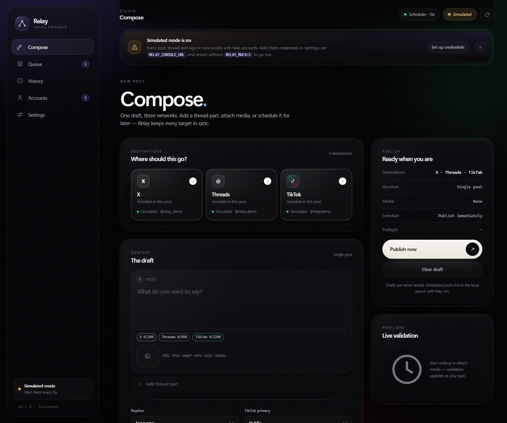

# Relay

**One publishing layer for every social channel — built for humans and AI agents.**

Relay is a self-hosted social publishing control plane. It gives creators and teams one place to compose, schedule, publish, comment, reply and delete across **X, Threads, TikTok, YouTube and Instagram** — through a browser console or any MCP-capable AI agent such as Claude, Cursor, Grok or DeepSeek Harness.

**Live:** <https://relay.duitpoket.fun> · **MCP:** `https://mcp.duitpoket.fun/mcp` · **5 platforms** · **19 agent tools**



---

## Investor snapshot

| | |
|---|---|
| **What it is** | A unified social publishing and conversation layer, exposed through both a console and the Model Context Protocol (MCP) |
| **Who it is for** | Solo creators, social teams, agencies, and anyone running AI-agent content workflows |
| **Platforms live** | X, Threads, TikTok, YouTube, Instagram |
| **Current stage** | Private beta — single-tenant production deployment |
| **Hosting** | Tencent Cloud Singapore + Cloudflare named tunnel |
| **Agent surface** | 19 MCP tools for publishing, scheduling, comments, replies, accounts and validation |
| **Automated tests** | 120 passing (unit + end-to-end) |
| **Data model** | Self-hosted; encrypted credentials; customer owns the data directory |
| **Business model** | Hosted subscription, self-hosted licence and usage-based API access are under evaluation — not yet monetised |

> Relay is deliberately focused. It is not another analytics dashboard. It is the **execution layer** between a content workflow and the social platforms.

---

## The problem

Publishing across multiple social platforms is still fragmented:

- Each network has its own OAuth flow, media rules, character limits, quotas and API quirks.
- Creators and small teams juggle five dashboards to do one job: get a post live.
- Existing tools are **dashboard-first**. They are built for a human clicking a UI, not for an AI agent that needs a clean, reliable API.
- Agencies and privacy-sensitive teams do not want their social tokens and content history sitting in a vendor's multi-tenant database.
- Comments, replies and long-form formats are usually separate products or not supported at all.

At the same time, AI agents are becoming the place where content is drafted, reviewed and executed. Those agents need a **trusted publishing tool**, not a browser automation script.

---

## The Relay proposition

**One control plane. Any client. Every channel.**

1. **Compose once, publish everywhere.** Text, images, video, threads, carousels, X Articles, comments and replies — with per-platform validation before anything is sent.
2. **Agent-native.** The same 19 tools are available to Claude, Cursor, Grok, DeepSeek Harness or any MCP client. Publishing becomes a tool call, not a screen-scrape.
3. **Own the data.** Relay runs on your machine or your cloud. Tokens are encrypted at rest. There is no Relay telemetry and no vendor database in the middle.
4. **Operate like infrastructure.** A scheduler, queue, retry and health checks run as services, even when the console is closed.
5. **Stay focused.** No analytics, no inbox, no approval bloat. Relay does the posting and conversation work exceptionally well.

---

## What is live today

### Channels

| Platform | Publishing | Conversation | Notes |
|---|---|---|---|
| **X** | Text, images, video, threads, quote posts, **X Articles** with inline images | Replies | Delete supported |
| **Threads** | Text, images, video, multi-part chains | Read comments, reply | Auto-reply available |
| **TikTok** | Video, photo carousels | — | Public posting depends on TikTok app audit |
| **YouTube** | Video upload | Read comments, reply | Daily API quota applies |
| **Instagram** | Image and Reel publishing | Read comments, reply | Business/Creator account required |

### Cross-platform capabilities

- Scheduling and a persistent queue
- Per-platform previews with auto-adapted variants
- Visual content calendar and recurring/evergreen schedules
- Per-platform options and validation
- Draft-level and per-platform reply targeting
- Post history, deletion and account status
- One shared encrypted data store across console and MCP
- Simulated mode for demos and development without live credentials

### The 19 MCP tools

| Group | Tools |
|---|---|
| **Accounts** | `relay_accounts`, `relay_connect`, `relay_disconnect`, `relay_console`, `relay_limits` |
| **Publishing** | `relay_post`, `relay_validate`, `relay_preview`, `relay_article`, `relay_article_validate` |
| **Queue & history** | `relay_queue`, `relay_cancel`, `relay_history`, `relay_delete` |
| **Conversation** | `relay_threads_comments`, `relay_threads_reply`, `relay_threads_autoreply`, `relay_comments_new`, `relay_reply` |

Every tool is available over stdio (local clients) and over authenticated Streamable HTTP (hosted agents such as Grok Bot).

---

## Why now

- **MCP is becoming the standard interface between agents and tools.** Claude, Cursor, Grok and DeepSeek Harness all support it. A publishing layer that speaks MCP can be used by every agent without custom integrations.
- **Agent-mediated content is moving from demo to daily workflow.** Drafting is already AI-assisted; publishing is still manual and fragmented.
- **Platform APIs are mature enough to unify.** The hard part is no longer "can we post?" — it is reliability, media rules, retries, quotas and conversation state.
- **Data ownership is a buying criterion.** Agencies and privacy-sensitive teams increasingly refuse to hand social tokens to another SaaS silo.

---

## How it works

```text
   AI agent (Claude / Cursor / Grok / DeepSeek)
                    │
          MCP over stdio or HTTPS
                    │
        ┌───────────▼───────────┐
        │      Relay MCP        │
        │  19 tools, auth,      │
        │  validation           │
        └───────────┬───────────┘
                    │
   Browser ──HTTP──▶ Relay console
                    │
        ┌───────────▼───────────┐
        │    Relay core         │
        │  scheduler · queue ·  │
        │  encrypted state      │
        └───────────┬───────────┘
                    │
      ┌─────────────┼─────────────┬─────────────┬─────────────┐
      ▼             ▼             ▼             ▼             ▼
      X          Threads        TikTok       YouTube      Instagram
```

**Deployment shape**

- `relay-console` and `relay-mcp` run as systemd services on Linux.
- Cloudflare named tunnel provides stable HTTPS hostnames.
- State lives in `/var/lib/relay/.data`; credentials are AES-256-GCM encrypted.
- Only one Relay process owns the scheduler lock, so scheduled posts fire once.

See [deploy/DEPLOY.md](deploy/DEPLOY.md) and [docs/ALWAYS-ON.md](docs/ALWAYS-ON.md).

---

## Why Relay wins

| | Relay | Dashboard-first tools |
|---|---|---|
| Agent-native MCP interface | ✅ Native | ❌ UI-first |
| Self-hosted / data ownership | ✅ Yes | ❌ Vendor cloud |
| Post + comment/reply in one layer | ✅ Yes | ⚠️ Partial |
| X Articles / long-form | ✅ Yes | ❌ Rare |
| Open architecture and adapters | ✅ Yes | ❌ Closed |
| Analytics and inbox | ❌ Deliberately not included | ✅ Yes |

Relay does not try to win on analytics breadth. It wins on **execution reliability, agent compatibility and data ownership** — the layer every AI content workflow needs.

---

## Business model (planned)

Three options are being evaluated; none is live yet:

1. **Relay Cloud** — managed hosting with per-seat or per-channel pricing.
2. **Relay Self-hosted** — annual licence for agencies and teams that need their own infrastructure.
3. **Agent API** — usage-based access for platforms and agent builders that need a publishing tool.

The wedge is the agent ecosystem: every MCP client that needs to publish becomes a distribution channel for Relay.

---

## Roadmap

**Now**
- Five live platforms, 19 MCP tools
- Per-platform previews and auto-threading variants
- Visual calendar plus recurring/evergreen scheduling
- Scheduling, queue, retries and health checks
- Comments and replies across Threads, Instagram and YouTube
- X Articles and post deletion

**Next**
- Analytics and a unified inbox
- Team workspaces and approval workflows
- Hosted multi-tenant Relay Cloud
- Audit logs and per-action permissions
- Additional platforms and webhooks

**Later**
- Agency white-label
- Template and campaign marketplace
- Deeper agent memory and content-plan integration

---

## Security and trust

- Tokens encrypted at rest with AES-256-GCM.
- Credentials never leave the Relay data directory.
- Console binds to localhost; public access is through a token-protected MCP endpoint and Cloudflare TLS.
- Per-account OAuth scopes — Relay only requests what a platform needs.
- No telemetry or third-party analytics.
- Scheduler lock prevents duplicate scheduled posts across processes.

---

## Quick start (technical)

```bash
git clone https://origin.cursor.com/ttrg/relay.git
cd relay
npm install
npm run build
npm run start
```

Open <http://127.0.0.1:4317>. Live posting requires developer apps for the platforms you enable; every platform also works in simulated mode without credentials.

**Use Relay from an MCP client**

```json
{
  "mcpServers": {
    "relay": {
      "type": "http",
      "url": "https://mcp.duitpoket.fun/mcp",
      "headers": { "Authorization": "Bearer <RELAY_MCP_TOKEN>" }
    }
  }
}
```

For local agents, use the stdio server:

```bash
node apps/mcp/dist/index.js --data-dir .data --console-url https://relay.duitpoket.fun
```

More: [Claude/MCP setup](docs/CLAUDE.md) · [Connect accounts](docs/CONNECT-ACCOUNTS.md) · [Going live](docs/GOING-LIVE.md) · [Architecture and operations](docs/ALWAYS-ON.md)

---

## Current limitations

- TikTok public posting depends on TikTok's app audit.
- YouTube uploads are bounded by the platform's daily API quota.
- Meta apps must stay in good standing; Threads and Instagram reconnects require valid redirect URIs.
- Relay is single-tenant today; multi-tenant hosting is on the roadmap.
- Analytics and inbox are intentionally out of scope for this release.

These are platform constraints or deliberate product boundaries — not hidden failures.

---

## Repository map

| Path | Purpose |
|---|---|
| `apps/web` | Browser console, OAuth callbacks, scheduler host |
| `apps/mcp` | MCP server (stdio + authenticated HTTP) |
| `packages/core` | Service, validation, encrypted store, scheduler |
| `packages/platforms` | X, Threads, TikTok, YouTube and Instagram adapters |
| `deploy` | systemd units, deploy script, Cloudflare example |
| `docs` | Product, operations and connection guides |
| `tests` | Unit and end-to-end tests |

---

## Contact

Relay is currently a private beta. For investor or partnership conversations, contact the repository owner.

**Live product:** <https://relay.duitpoket.fun>
**Source:** <https://origin.cursor.com/ttrg/relay>
