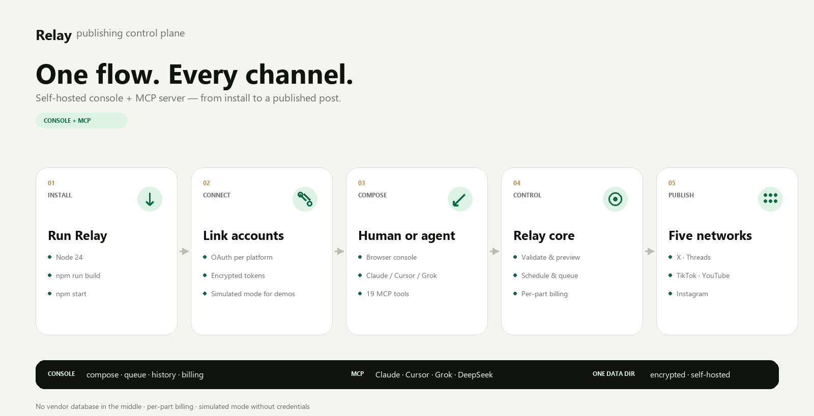

# Relay

**One publishing layer for every social channel — built for humans and AI agents.**

Relay is a self-hosted social publishing control plane. It gives creators and teams one place to compose, schedule, publish, comment, reply and delete across **X, Threads, TikTok, YouTube, Instagram and LinkedIn** — through a browser console or any MCP-capable AI agent such as Claude, Cursor, Grok or DeepSeek Harness.

**Live:** <https://relay.duitpoket.fun> · **MCP:** `https://mcp.duitpoket.fun/mcp` · **6 platforms** · **19 agent tools**



---

## What Relay is

Relay is the **execution layer** between a content workflow and the social platforms.

| Piece | What it does |
|---|---|
| **Console** | Compose, preview, schedule, queue, history, accounts and billing |
| **MCP server** | The same publish/schedule/comment tools for Claude, Cursor, Grok and other agents |
| **Relay core** | Validation, media rules, encrypted credentials, scheduler, queue lock and retries |
| **Adapters** | X, Threads, TikTok, YouTube, Instagram and LinkedIn API integrations |

It is not an analytics dashboard, inbox or social CRM. It does one job: get content published reliably and let humans and agents operate the same control plane.

---

## Production status

Relay is **ready for a controlled production deployment**, not yet a fully self-service SaaS.

| Area | Status |
|---|---|
| Console, queue, history, accounts, billing screen | ✅ Live |
| Six platform adapters | ✅ Live, subject to each platform's app approval and quotas |
| MCP over stdio and authenticated HTTP | ✅ Live |
| Per-part billing and $0.50 starter credit | ✅ Implemented |
| Unit, integration and end-to-end tests | ✅ **169 passing** |
| Health checks, readiness script and link audit | ✅ Passing |
| Backups, uptime alerting and process supervision | ✅ Configured |
| Live card checkout | ⛔ Not configured — manual/operator top-ups only |
| Self-service signup and customer portal | ⛔ Not implemented |
| Transactional email | ⛔ Not configured |
| Full real-account E2E across every platform | ⚠️ Depends on platform approval, credentials and content |

**Honest summary:** the software and deployment are production-ready for a controlled/self-hosted rollout. The commercial SaaS layer — live payments, self-service onboarding, email and billing automation — is the remaining gap.

---

## Quick start

### Requirements

- **Node.js 24** recommended. Minimum supported by the repo is **22.18**; Node 24 is what production runs.
- npm 10+
- Platform developer apps and OAuth credentials for any network you want to publish to live.

### 1. Install

```bash
git clone https://github.com/firyomaefx/relay.git
cd relay
npm install
npm run build
```

### 2. Run the tests

```bash
npm test
```

Expected: **169 tests passing**.

### 3. Start the console

```bash
npm start
```

Or on Windows, double-click **[start-relay.cmd](start-relay.cmd)**.

Open <http://127.0.0.1:4317>.

Every platform runs in **simulated mode** until credentials are added. You can compose, preview, queue and publish end-to-end without touching a real account.

### 4. Configure credentials

Copy the reference file:

```bash
cp .env.example .env
```

Edit the values you need. Relay loads the repo-root `.env` automatically; explicitly exported environment variables always win.

For production, use your service manager's environment file rather than a repo `.env`.

Common variables:

| Variable | Purpose |
|---|---|
| `RELAY_DATA_DIR` | Data directory; defaults to `./.data` |
| `RELAY_HOST` / `RELAY_PORT` | Console bind address; defaults `127.0.0.1:4317` |
| `RELAY_CONSOLE_PASSWORD` | Required when the console is exposed beyond localhost |
| `RELAY_PUBLIC_MEDIA_BASE_URL` | Public URL for uploaded media (required for Threads/TikTok media) |
| `RELAY_MOCK=1` | Force simulated mode; no real API calls |
| `X_CLIENT_ID` / `X_CLIENT_SECRET` | X OAuth app |
| `THREADS_CLIENT_ID` / `THREADS_CLIENT_SECRET` | Threads app |
| `TIKTOK_CLIENT_KEY` / `TIKTOK_CLIENT_SECRET` | TikTok content posting app |
| `YOUTUBE_CLIENT_ID` / `YOUTUBE_CLIENT_SECRET` | Google/YouTube OAuth |
| `INSTAGRAM_CLIENT_ID` / `INSTAGRAM_CLIENT_SECRET` | Meta/Instagram app |
| `LINKEDIN_CLIENT_ID` / `LINKEDIN_CLIENT_SECRET` | LinkedIn app with Sign In + Share on LinkedIn |

See [.env.example](.env.example) for the full list and comments.

---

## Connect accounts

1. Open the console and sign in.
2. Go to **Accounts**.
3. Choose a platform and click **Connect**.
4. Complete OAuth in the browser.
5. Return to Relay and confirm the account shows **Live**.

Threads and Instagram need valid redirect URIs in the Meta app. TikTok public posting depends on TikTok app audit. YouTube uploads are bounded by the daily API quota.

Detailed guides:

- [Connect accounts](docs/CONNECT-ACCOUNTS.md)
- [Going live](docs/GOING-LIVE.md)
- [Claude/MCP setup](docs/CLAUDE.md)

---

## Use the console

| Screen | What you do there |
|---|---|
| **Compose** | Pick platforms, write text, attach media, add thread parts, validate, preview and publish or schedule |
| **Queue** | Inspect scheduled and recurring jobs, cancel pending jobs |
| **History** | See every published/scheduled record and per-platform result |
| **Accounts** | Connect, disconnect and check live/simulated status |
| **Billing** | Available credit, starter credit, payment history and top-up guidance |
| **Settings** | Credentials, MCP connection details and console configuration |

The console and MCP server share one encrypted data directory. Publishing from Claude or Cursor appears in the same history as a post written in the browser.

---

## Use Relay from an AI agent

### Hosted HTTP MCP

```json
{
  "mcpServers": {
    "relay": {
      "type": "http",
      "url": "https://mcp.duitpoket.fun/mcp",
      "headers": {
        "Authorization": "Bearer <RELAY_MCP_TOKEN>"
      }
    }
  }
}
```

### Local stdio MCP

```json
{
  "mcpServers": {
    "relay": {
      "command": "node",
      "args": [
        "C:/path/to/relay/apps/mcp/dist/index.js"
      ],
      "env": {
        "RELAY_DATA_DIR": "C:/path/to/relay/.data",
        "RELAY_CONSOLE_URL": "http://127.0.0.1:4317"
      }
    }
  }
}
```

Start the HTTP MCP server locally:

```bash
npm run mcp:http
```

Default HTTP port: `4320`.

### Tool groups

| Group | Tools |
|---|---|
| **Accounts** | `relay_accounts`, `relay_connect`, `relay_disconnect`, `relay_console`, `relay_limits` |
| **Publishing** | `relay_post`, `relay_validate`, `relay_preview`, `relay_article`, `relay_article_validate` |
| **Queue and history** | `relay_queue`, `relay_cancel`, `relay_history`, `relay_delete` |
| **Conversation** | `relay_threads_comments`, `relay_threads_reply`, `relay_threads_autoreply`, `relay_comments_new`, `relay_reply` |

---

## Billing model

Relay prices **one post part on one platform** as one billable unit.

| Draft | Billable units | Price |
|---|---:|---:|
| Text post on X | 1 | $0.02 |
| Text post on X + Threads | 2 | $0.04 |
| 3-part thread on X + Threads | 6 | $0.12 |
| Video post on all five networks | 5 | $0.20 |

- **Text:** $0.02 per part, per platform
- **Video:** $0.04 per part, per platform
- **Starter credit:** **$0.50**, spent at the real unit price
- **X:** excluded from free starter credit
- **Failed posts:** not charged
- **Published parts:** quoted before publishing, reserved, then settled per successful platform

`relay_validate` returns the quote and per-part cost estimate before you publish.

Billing is implemented in the **cloud MCP** mode. Self-hosted owner mode is not charged. See [billing model](docs/product/billing-model.md).

### Live payments

Production currently has **no live payment provider configured**. The Billing screen truthfully states that live card checkout is not configured and directs top-ups through the operator. Adding a live provider is a separate integration step.

### Cloud account slots

- **$10 lifetime paid top-up** unlocks **3 accounts per platform**
- **$50 lifetime paid top-up** unlocks **10 accounts per platform**
- Free starter credit does not count
- The first account per platform is the baseline
- `relay_cloud_accounts` shows the tier, used slots and remaining slots
- `relay_connect` accepts `account_id` and `label` for additional accounts
- `relay_post` accepts `account_ids` to choose the publishing account per platform
- Auto-reply currently runs on the primary Threads account only; extra Threads accounts do not auto-reply

### Automatic Threads replies

Cloud auto-reply is gated:

- **$10 minimum lifetime paid top-up** — free starter credit does not count
- **Your own DeepSeek API key** — stored encrypted per tenant and never returned
- **A connected Threads account** with `threads_read_replies` + `threads_manage_replies`
- **30-minute window** after a Threads post; spam and hostile comments are skipped

Use the cloud-only `relay_cloud_autoreply` tool with `status`, `set_key`, `clear_key`, `enable` or `disable`. Explicit `relay_reply` / `relay_threads_reply` calls remain available without the unlock.

---

## Operations

| Concern | How Relay handles it |
|---|---|
| **Scheduler** | One process owns the lock, so scheduled jobs fire once |
| **Health** | `/api/health` on the console and `/health` on Cloud MCP |
| **Data** | Local data directory with encrypted credentials |
| **Backups** | Operator-managed encrypted snapshots with lifecycle retention |
| **Monitoring** | Operator-managed uptime checks and alerting |
| **Readiness** | `node tools/production-readiness.mjs` |
| **Links** | `node tools/audit-live-links.mjs` |
| **Deploy** | [deploy/DEPLOY.md](deploy/DEPLOY.md) and [docs/ALWAYS-ON.md](docs/ALWAYS-ON.md) |

Production reference deployment:

- GCP VM in Singapore
- Cloudflare named tunnel for `relay`, `mcp` and `cloud-mcp` hostnames
- systemd services for console and cloud MCP
- SQLite ledger and encrypted platform credentials

---

## Repository map

| Path | Purpose |
|---|---|
| `apps/web` | Browser console, OAuth callbacks, scheduler host |
| `apps/mcp` | MCP server (stdio + authenticated HTTP) and cloud finance hooks |
| `packages/core` | Service, validation, encrypted store, scheduler, previews |
| `packages/platforms` | X, Threads, TikTok, YouTube, Instagram and LinkedIn adapters |
| `packages/cloud` | Cloud store, pricing, ledger, tenants and rate limits |
| `deploy` | systemd units, deploy script and Cloudflare example |
| `docs` | Product, billing, operations and connection guides |
| `tests` | Unit and end-to-end tests |

---

## Testing

```bash
npm test
```

Covers unit, adapter and end-to-end flows, including:

- per-part quoting and settlement
- free-credit exhaustion and X exclusion
- scheduling and queue locking
- platform adapters and validation
- cloud admin, billing and payment webhooks
- console auth and API routes

Production verification:

```bash
node tools/production-readiness.mjs
node tools/audit-live-links.mjs
```

---

## Security

- Credentials encrypted at rest with AES-256-GCM.
- Console binds to localhost by default; set `RELAY_CONSOLE_PASSWORD` before exposing it.
- MCP HTTP requests require a bearer token or OAuth.
- No telemetry and no third-party analytics.
- Never commit `.env`, credentials, tokens or the data directory.
- The scheduler lock prevents duplicate scheduled posts.

---

## Current limitations

- TikTok public posting depends on TikTok app audit.
- YouTube uploads are bounded by the platform's daily API quota.
- Threads and Instagram reconnects require valid Meta redirect URIs.
- LinkedIn live posting requires LinkedIn app approval and the Share on LinkedIn permission; without credentials it runs in simulated mode.
- LinkedIn company pages are not implemented yet.
- Live card checkout, self-service signup, customer portal and transactional email are not implemented.
- Analytics and a unified inbox are intentionally out of scope.
- Relay is currently single-tenant per deployment; multi-tenant cloud mode exists but onboarding is operator-driven.

---

## License and source

Source: <https://github.com/firyomaefx/relay>

See [LICENSE](LICENSE).

**Live product:** <https://relay.duitpoket.fun>
**MCP endpoint:** `https://mcp.duitpoket.fun/mcp`


